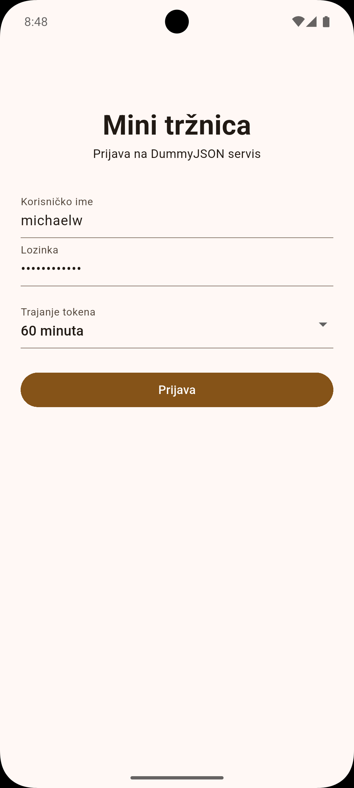
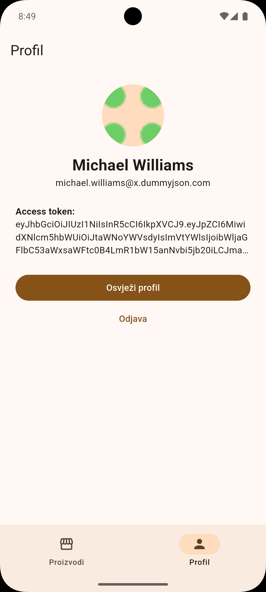
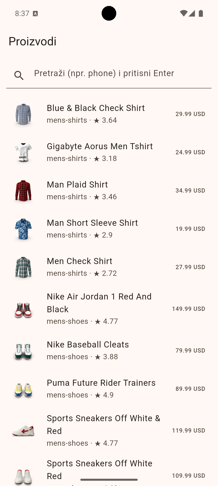
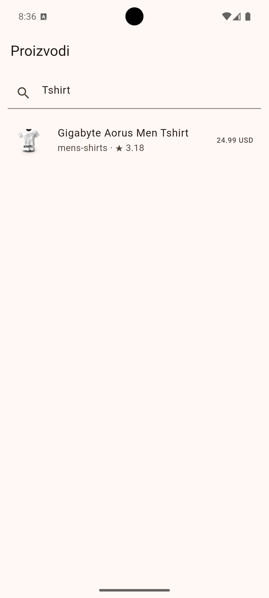
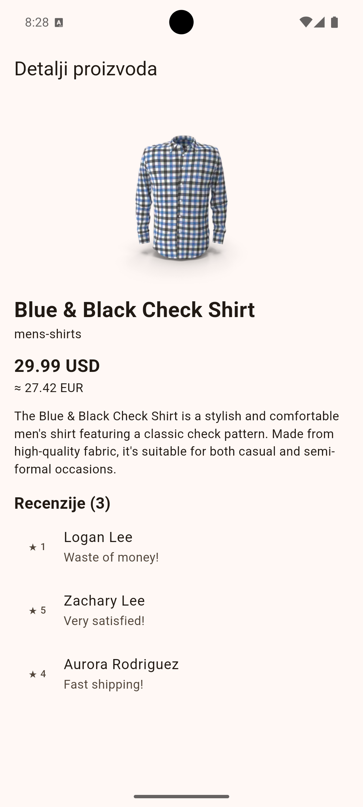
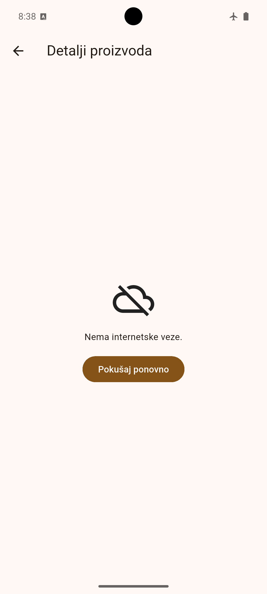
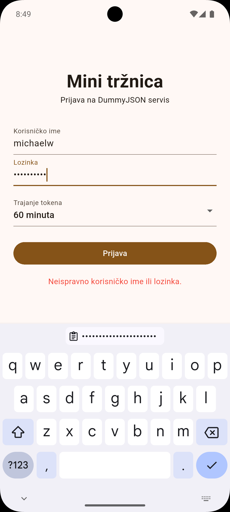

# Korištenje udaljenih servisa i servisa treće strane u Flutteru

## Opis projekta

U ovom sam projektu obradio korištenje udaljenih servisa i servisa treće strane na primjeru aplikacije **Mini tržnica**. Aplikacija omogućuje prijavu korisnika, prikazuje popis muške odjeće, obuće i satova, pretragu i detalje pojedinog proizvoda, a cijenu proizvoda preračunava u eure prema današnjem tečaju. Cilj projekta je pokazati kako mobilna aplikacija preko REST-a dohvaća JSON podatke s udaljenih servisa, pretvara ih u objekte, prikazuje ih korisniku i obrađuje pogreške.

**Udaljeni servis** je servis koji se ne nalazi na uređaju, nego na poslužitelju, a aplikacija s njim komunicira HTTP zahtjevima. **Servis treće strane** je udaljeni servis koji je razvio i održava netko drugi, a aplikacija ga samo koristi. U ovom projektu koriste se tri takva servisa na dva različita poslužitelja. Svaki ima svoju odgovornost, što iz perspektive klijenta odgovara ideji **mikroservisa**.

## Tehnologije

1. Dart – programski jezik
2. Flutter – razvojni okvir za izradu korisničkog sučelja
3. `http` – slanje HTTP zahtjeva prema udaljenim servisima
4. `dart:convert` – pretvorba JSON-a u Dart objekte i obrnuto
5. Android Studio – razvojno okruženje, emulator Pixel 8 (API 35)

## Korišteni servisi

| Servis | Adresa | Namjena |
|---|---|---|
| DummyJSON Auth | `https://dummyjson.com/auth` | prijava, podaci korisnika, osvježavanje tokena |
| DummyJSON Products | `https://dummyjson.com/products` | popis, pretraga i detalji proizvoda |
| Frankfurter | `https://api.frankfurter.dev/v1` | tečaj USD → EUR |

## Primjeri

1. **Prijava i tokeni** – korisničko ime i lozinka šalju se servisu (`POST /auth/login`), a on vraća access i refresh token. Access token šalje se uz zaštićene zahtjeve u zaglavlju `Authorization: Bearer`. Kad istekne, servis vraća 401, a aplikacija refresh tokenom sama dobiva novi access token i ponavlja zahtjev. Na ekranu za prijavu može se odabrati trajanje tokena od 1 minute kako bi se to moglo isprobati.

| Prijava | Profil |
|---|---|
|  |  |

2. **Dohvat i prikaz podataka** – popis se gradi iz tri zahtjeva, po jedan za svaku mušku kategoriju (`mens-shirts`, `mens-shoes`, `mens-watches`), a pretraga koristi `GET /products/search?q=…`. JSON odgovor pretvara se u objekte `Product` i prikazuje u popisu. Slike nisu dio JSON-a, nego se preuzimaju s adrese navedene u polju `thumbnail`.

| Proizvodi | Pretraga |
|---|---|
|  |  |

3. **Kombiniranje dvaju servisa** – na detaljima proizvoda cijena u USD dolazi s DummyJSON-a, a tečaj s Frankfurtera. Ako servis za tečaj ne radi, prikazuje se poruka *„Cijena u EUR trenutno nije dostupna.”*, a ostatak ekrana radi normalno.



4. **Obrada pogrešaka** – svi zahtjevi prolaze kroz jednu funkciju koja tehničke pogreške pretvara u poruke za korisnika. Ekran tada umjesto podataka prikazuje poruku i gumb *Pokušaj ponovno*.

| Situacija | Poruka korisniku |
|---|---|
| nema interneta | Nema internetske veze. |
| poslužitelj ne odgovara 10 s | Poslužitelj ne odgovara. |
| odgovor nije ispravan JSON | Odgovor poslužitelja nije ispravan JSON. |
| pogrešna lozinka (HTTP 400) | Neispravno korisničko ime ili lozinka. |
| istekao refresh token (HTTP 401) | Sesija je istekla. Prijavite se ponovno. |

| Nema interneta | Pogrešna prijava |
|---|---|
|  |  |

## Arhitektura

Aplikacija prati arhitekturu koju preporučuje službena Flutter dokumentacija, tj. **MVVM**:

```
View (ekran) -> ViewModel -> Repository ->Service -> udaljeni servis
```

**Service** samo šalje zahtjeve jednom servisu, **Repository** je jedini izvor podataka i čuva tokene, **ViewModel** drži stanje ekrana (učitavanje, podaci, greška), a **View** to stanje prikazuje.

## Ključni dijelovi koda

Pretvorba JSON-a u objekt:

```dart
factory Product.fromJson(Map<String, dynamic> json) {
  return Product(
    id: json['id'],
    title: json['title'],
    price: (json['price'] as num).toDouble(),
    thumbnail: json['thumbnail'],
  );
}
```

Zahtjev s access tokenom:

```dart
http.get(
  Uri.parse('$baseUrl/me'),
  headers: {'Authorization': 'Bearer $accessToken'},
)
```

Osvježavanje tokena nakon odgovora 401:

```dart
try {
  return await service.getMe(accessToken!);
} on UnauthorizedException {
  final tokens = await service.refresh(refreshToken!, minutes);
  accessToken = tokens.accessToken;
  refreshToken = tokens.refreshToken;
  return await service.getMe(accessToken!);
}
```
Testni korisnik: `michaelw` / `michaelwpass` (već upisano na ekranu za prijavu).

## Napomena o OAuth 2.0

DummyJSON nije potpuni OAuth 2.0 poslužitelj, jer mu aplikacija izravno šalje korisničko ime i lozinku. Za mobilne aplikacije preporučuje se tok **Authorization Code + PKCE**, u kojem se korisnik prijavljuje u pregledniku kod pružatelja identiteta (npr. Google ili GitHub), a aplikacija nikad ne vidi lozinku. Taj je tok objašnjen u prezentaciji, a DummyJSON je odabran jer ne traži registraciju, a omogućuje prikaz rada s access i refresh tokenima.

## Literatura

* [Flutter – Guide to app architecture](https://docs.flutter.dev/app-architecture/guide) – preporučena MVVM arhitektura.
* [Flutter – Fetch data from the internet](https://docs.flutter.dev/cookbook/networking/fetch-data) – dohvat podataka paketom `http`.
* [Flutter – Make authenticated requests](https://docs.flutter.dev/cookbook/networking/authenticated-requests) – slanje tokena u zaglavlju.
* [Flutter – JSON and serialization](https://docs.flutter.dev/data-and-backend/serialization/json) – pretvorba JSON-a u objekte.
* [Dart – paket `http`](https://pub.dev/packages/http) – dokumentacija paketa za HTTP zahtjeve.
* [DummyJSON – dokumentacija](https://dummyjson.com/docs) – prijava, tokeni i proizvodi.
* [Frankfurter API](https://frankfurter.dev) – tečajevi valuta.
* [Fielding, R. T. (2000) – REST](https://ics.uci.edu/~fielding/pubs/dissertation/top.htm) – disertacija u kojoj je definiran REST.
* [Lewis, J., Fowler, M. – Microservices](https://martinfowler.com/articles/microservices.html) – opis arhitekture mikroservisa.
* [RFC 6749 – OAuth 2.0](https://datatracker.ietf.org/doc/html/rfc6749), [RFC 6750 – Bearer token](https://datatracker.ietf.org/doc/html/rfc6750), [RFC 7519 – JWT](https://datatracker.ietf.org/doc/html/rfc7519), [RFC 7636 – PKCE](https://datatracker.ietf.org/doc/html/rfc7636) – standardi za autorizaciju i tokene.
* [RFC 8259 – JSON](https://datatracker.ietf.org/doc/html/rfc8259) – specifikacija formata JSON.
* Materijali s predavanja i laboratorijskih vježbi iz kolegija RAMPU, FOI Varaždin, 2026.